# Robot descriptions

Robot descriptions and their supporting meshes, launch files, and configuration.

## URDF exterior previews

The images show URDF visual meshes in a static pose. Joints are at zero or the nearest position allowed by their limits.

| Model | URDF file | Preview | Documentation |
| --- | --- | --- | --- |
| A1 | [`A1_URDF_0607_0028.urdf`](a1_description/urdf/A1_URDF_0607_0028.urdf) | <a href="a1_description/previews/a1_urdf_0607_0028.png">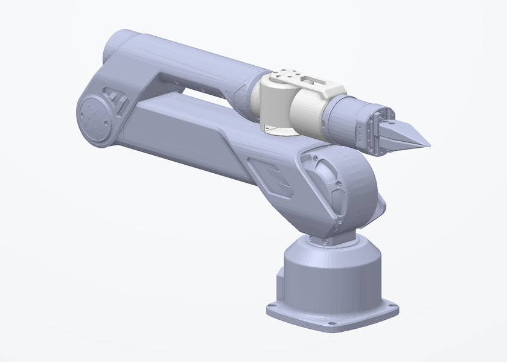</a> | [README](a1_description/README.md) |
| A1X | [`a1x.urdf`](a1x_description/urdf/a1x.urdf) | <a href="a1x_description/previews/a1x.png">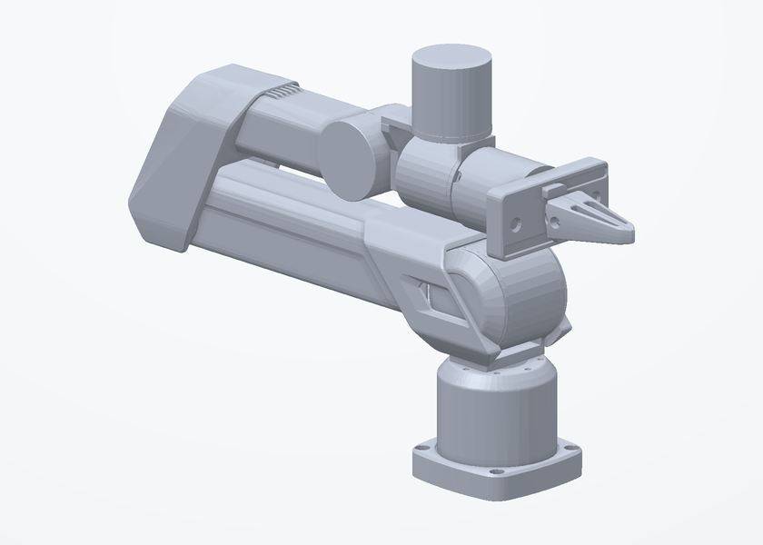</a> | [README](a1x_description/README.md) |
| A1Y | [`a1y.urdf`](a1y_description/urdf/a1y.urdf) | <a href="a1y_description/previews/a1y.png">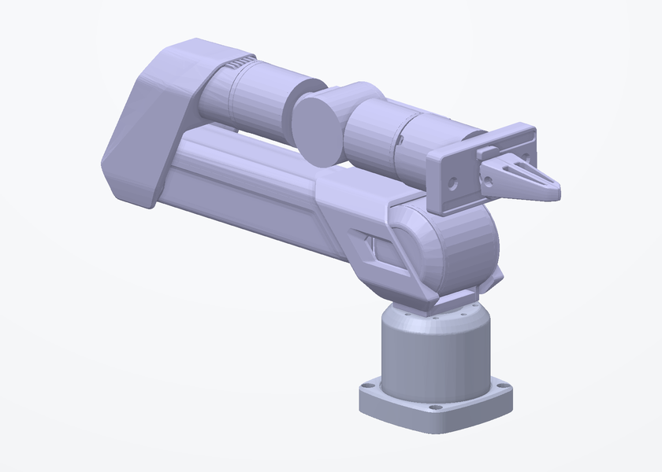</a> | [README](a1y_description/README.md) |
| A1Z Flange | [`A1Z_Flange.urdf`](a1z_description/a1z_flange_description/urdf/A1Z_Flange.urdf) | <a href="a1z_description/a1z_flange_description/previews/a1z_flange.png">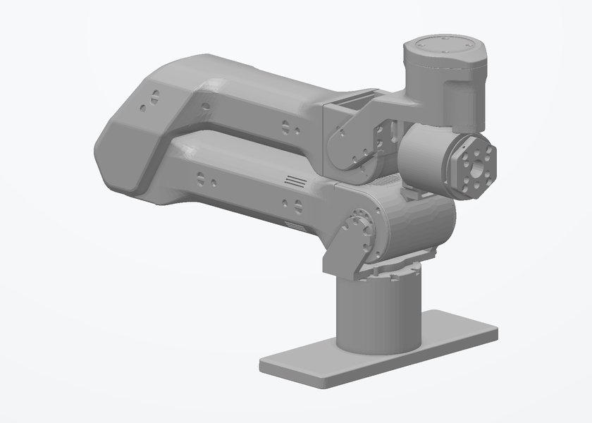</a> | [README](a1z_description/a1z_flange_description/README.md) |
| A1Z G1Z | [`A1Z_G1Z.urdf`](a1z_description/a1z_g1z_description/urdf/A1Z_G1Z.urdf) | <a href="a1z_description/a1z_g1z_description/previews/a1z_g1z.png">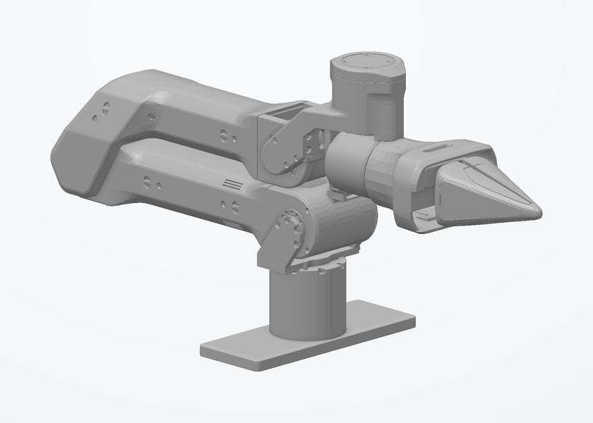</a> | [README](a1z_description/a1z_g1z_description/README.md) |
| A1Z G1Z Camera | [`A1Z_G1Z_CAMERA.urdf`](a1z_description/a1z_g1z_camera_description/urdf/A1Z_G1Z_CAMERA.urdf) | <a href="a1z_description/a1z_g1z_camera_description/previews/a1z_g1z_camera.png">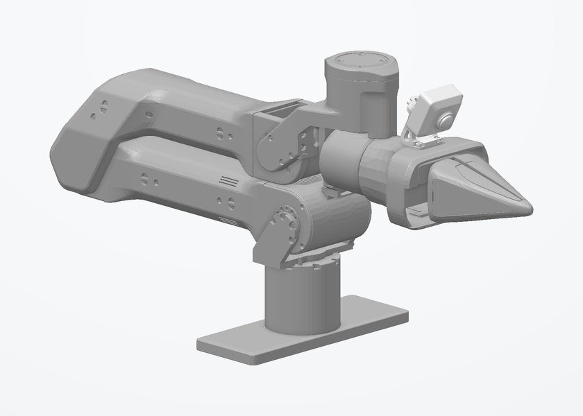</a> | [README](a1z_description/a1z_g1z_camera_description/README.md) |
| LEMO | [`LEMO.urdf`](lemo_description/urdf/LEMO.urdf) | <a href="lemo_description/previews/lemo.png">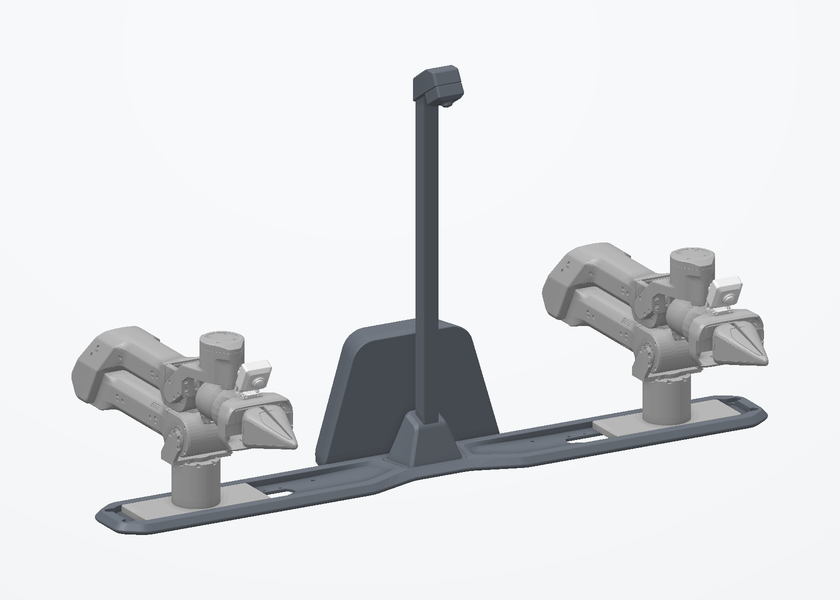</a> | [README](lemo_description/README.md) |
| R1 | [`r1_v2_1_0.urdf`](r1_description/urdf/r1_v2_1_0.urdf) | <a href="r1_description/previews/r1_v2_1_0.png">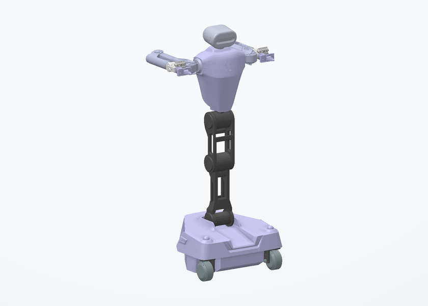</a> | [README](r1_description/README.md) |
| R1 Lite 2025 | [`urdf_r1lite_2025.urdf`](r1lite_description/urdf_r1lite_2025.urdf) |  | [README](r1lite_description/README.md) |
| R1 Lite 2026 A1X | [`urdf_r1lite_2026_a1x.urdf`](r1lite_description/urdf_r1lite_2026/urdf_r1lite_2026_a1x.urdf) | <a href="r1lite_description/urdf_r1lite_2026/previews/urdf_r1lite_2026_a1x.png">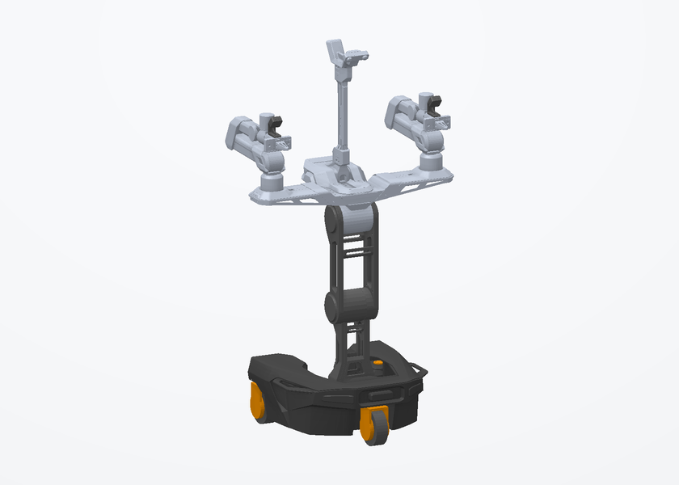</a> | [README](r1lite_description/urdf_r1lite_2026/README.md) |
| R1 Lite 2026 A1Z | [`urdf_r1lite_2026_a1z.urdf`](r1lite_description/urdf_r1lite_2026/urdf_r1lite_2026_a1z.urdf) | <a href="r1lite_description/urdf_r1lite_2026/previews/urdf_r1lite_2026_a1z.png">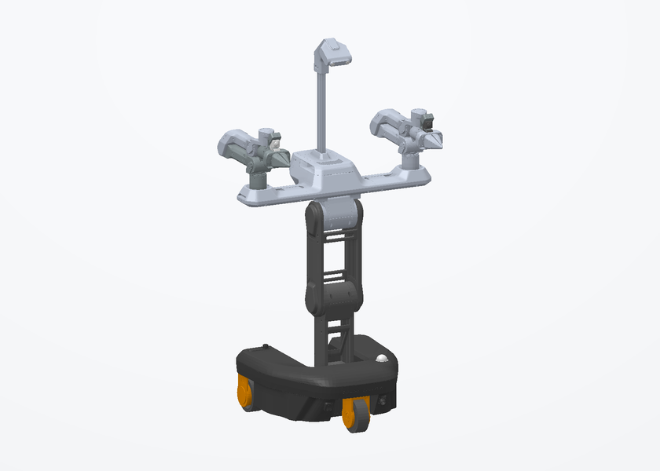</a> | [README](r1lite_description/urdf_r1lite_2026/README.md) |
| R1 Pro 2025 (approximate) | [`urdf_r1pro_2025.urdf`](r1pro_description/urdf_r1pro_2025.urdf) | <a href="r1pro_description/previews/urdf_r1pro_2025.png">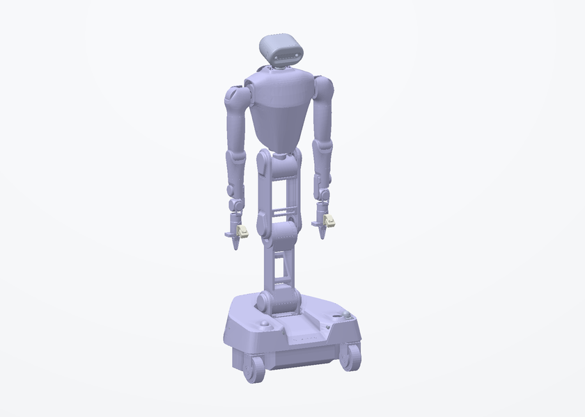</a> | [README](r1pro_description/README.md) |
| R1 Pro 2026 G1Z | [`r1pro_2026.urdf`](r1pro_description/r1pro_g1z_2026_description/urdf/r1pro_2026.urdf) | <a href="r1pro_description/r1pro_g1z_2026_description/previews/r1pro_2026.png">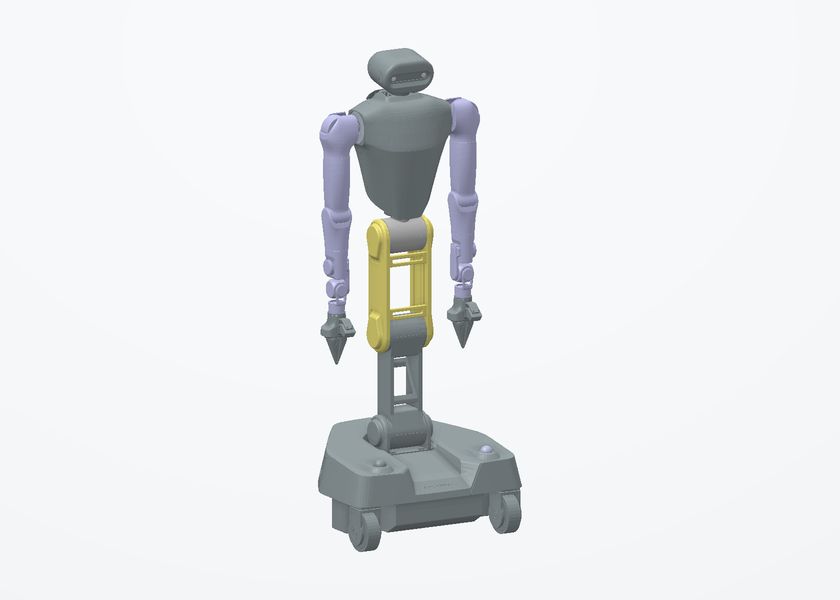</a> | [README](r1pro_description/r1pro_g1z_2026_description/README.md) |
| Legacy mobile platform with A1X arms | [`mmp_revB_invconfig_upright_a1x.urdf`](a1x_description/meshes/mmp_revB_invconfig_upright_a1x.urdf) | <a href="a1x_description/previews/mmp_revb_invconfig_upright_a1x.png">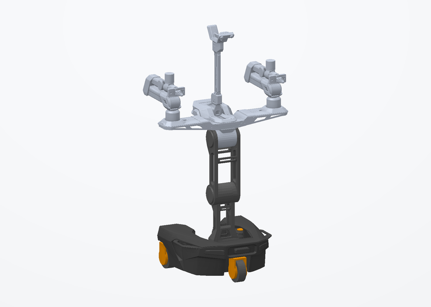</a> | [README](a1x_description/README.md) |

R1 Lite and the legacy mobile A1X preview use the corresponding mesh sets from the separate R1 Lite ROS 2 description package.

See the [A1Z model comparison](a1z_description/README.md) and the [mesh sources for the approximate R1 Pro 2025 preview](r1pro_description/README.md).

## ROS package names

ROS package names have changed. Update downstream launch files, package dependencies,
`package://` paths, and Isaac Sim ROS package mappings to use the new names.

| Previous ROS package | Current ROS package |
| --- | --- |
| `A1_URDF_0607_0028` | `a1_description` |
| `a1x` | `a1x_description` |
| `a1y` | `a1y_description` |
| `A1Z_Flange` | `a1z_flange_description` |
| `A1Z_G1Z` | `a1z_g1z_description` |
| `r1_v2_1_0` | `r1_description` |
| `r1pro_urdf` | `r1pro_g1z_2026_description` |
| `lemo_description` | `lemo_description` |
