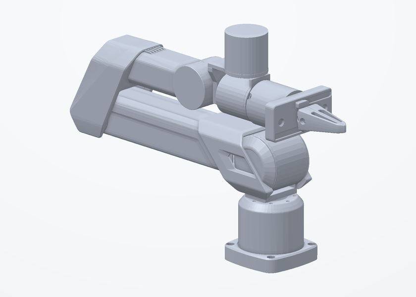
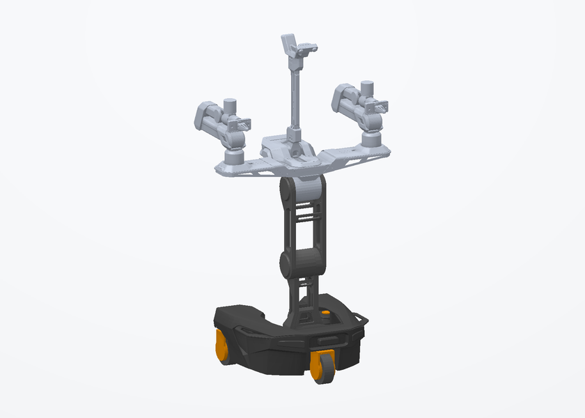

# A1X robot description

## URDF exterior previews

| Model | URDF file | Preview |
| --- | --- | --- |
| A1X | [`a1x.urdf`](urdf/a1x.urdf) |  |
| Legacy mobile platform with A1X arms | [`mmp_revB_invconfig_upright_a1x.urdf`](meshes/mmp_revB_invconfig_upright_a1x.urdf) |  |

The legacy mobile platform preview uses the R1 Lite ROS 2 mesh set.
