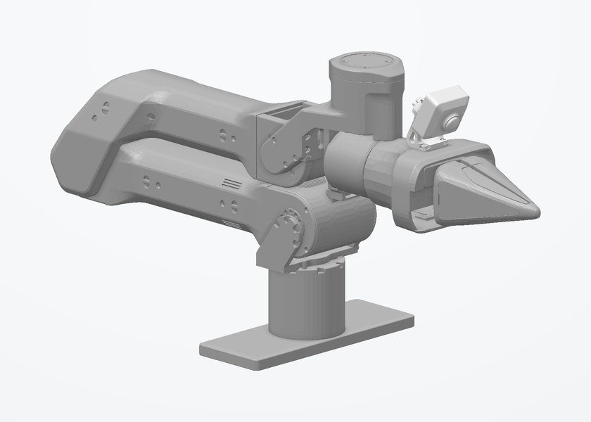
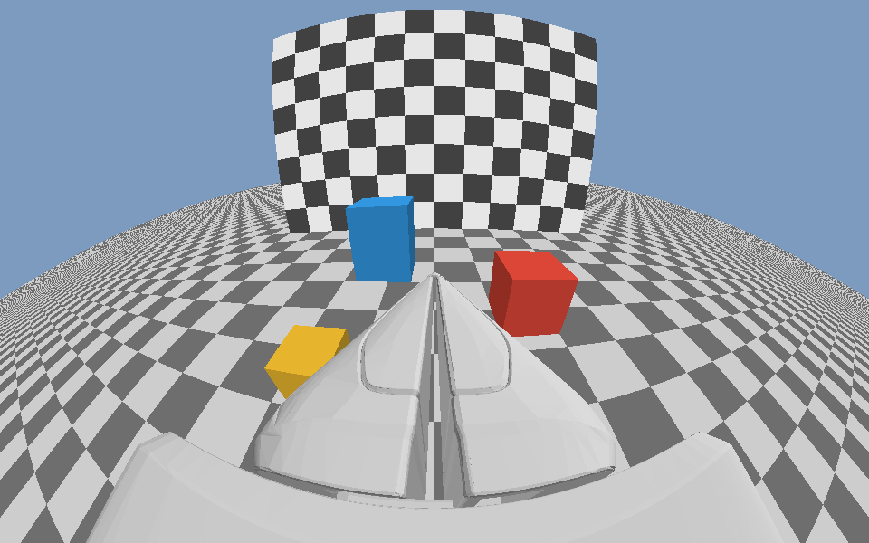

# A1Z G1Z camera

## URDF exterior previews

| Model | URDF file | Preview |
| --- | --- | --- |
| A1Z G1Z Camera | [`A1Z_G1Z_CAMERA.urdf`](urdf/A1Z_G1Z_CAMERA.urdf) | <a href="previews/a1z_g1z_camera.png"></a> |

基于 `a1z_g1z_description` 的带相机版本，保留原机械臂及夹爪定义，新增
`arm_link6 -> camera_link -> camera_optical_frame` 两个固定关节。
相机外观为白色；当前安装原点为 `(61.25, 0, 31.10) mm`，
光心相对 `arm_link6` 为 `(85.04, 0, 58.98) mm`，视线向下倾斜 28°。

包保留 ROS 1 catkin 构建及 launch，同时提供独立的 ROS 2 Jazzy / RViz2
预览入口；它并非已移植为 ament 的 ROS 2 包。

| 路径 | 内容 |
| --- | --- |
| [urdf/A1Z_G1Z_CAMERA.urdf](urdf/A1Z_G1Z_CAMERA.urdf) | 机械臂、夹爪、相机安装及光心坐标系 |
| [config/camera_info.yaml](config/camera_info.yaml) | 1920×1200 原始图像的鱼眼 K、D |
| [config/camera_metadata.yaml](config/camera_metadata.yaml) | 光学 frame、厂家标称 FOV 及参数来源 |
| [preview/run_preview.py](preview/run_preview.py) | ROS 2 模型、关节滑块和鱼眼画面预览 |
| [preview/mesh_occlusion.cpp](preview/mesh_occlusion.cpp) | 实际 STL 的 BVH 自遮挡计算 |
| [preview/verify_occlusion.py](preview/verify_occlusion.py) | 离线几何验证及示例图片生成 |

## Mounting transforms

All positions below are in metres. The supplied distances are interpreted as
positive X and positive Z in `arm_link6`, with Y = 0. `camera_link` is rotated
-90 degrees about `arm_link6` Z (clockwise viewed from +Z toward the origin).
Its STL is used as supplied, at unit scale. The mounting translation remains
expressed in `arm_link6` and does not rotate with the child frame.
The optical frame moves rigidly with the camera assembly.

| Parent | Child | xyz (m) | rpy (rad) |
| --- | --- | --- | --- |
| `arm_link6` | `camera_link` | `0.06125 0 0.0311` | `0 0 -1.570796326794897` |
| `camera_link` | `camera_optical_frame` | `0 0.02379 0.02788` | `-2.059488517353309 0 0` |

The optical origin relative to `arm_link6` is therefore
`(0.08504, 0, 0.05898)`. The second translation is calculated in the rotated mounting frame:
`Rz(+90 deg) * (p_optical - p_mount) = (0, 0.02379, 0.02788)`.

“Looking down 28 degrees” means looking from +X toward -Z in `arm_link6`.
The optical frame uses +Z forward, +X right and +Y down. Its composed rotation relative to `arm_link6` is
`Ry(28 deg) * Rz(-90 deg) * Rx(-90 deg)`, equivalent to URDF RPY
`(-118 deg, 0, -90 deg)`. Relative to the rotated `camera_link`, its RPY
is `(-118 deg, 0, 0)`. Its forward axis expressed in `arm_link6` is
`(0.8829475929, 0, -0.4694715628)`.

## 相对 A1Z 基座的相机外参

下文 `base` 指 `base_link`，`camera` 指 **`camera_optical_frame`**，
不是相机外壳坐标系 `camera_link`。采用齐次列向量，平移单位为 **米**。
记号 ${}^{A}T_{B}$ 表示把 B 坐标系下的点转换到 A 坐标系：

$$
p_{\mathrm{base}} = {}^{\mathrm{base}}T_{\mathrm{camera}}\,p_{\mathrm{camera}}.
$$

### 零位外参：相机坐标 → 基座坐标

按当前 URDF，**J1～J6 全部为 0 rad** 时：

```text
base_T_camera =
[[ 0.00000000, -0.46947156,  0.88294759,  0.18354000],
 [-1.00000000,  0.00000000,  0.00000000,  0.00000000],
 [ 0.00000000, -0.88294759, -0.46947156,  0.23698000],
 [ 0.00000000,  0.00000000,  0.00000000,  1.00000000]]
```

即零位时光心在基座下的位置为 `(183.54, 0, 236.98) mm`。

### 零位外参：基座坐标 → 相机光学坐标

将基座下的三维点投影到图像时，先使用逆矩阵把点变换到光学坐标系：

$$
p_{\mathrm{camera}} = {}^{\mathrm{camera}}T_{\mathrm{base}}\,p_{\mathrm{base}},
\qquad
{}^{\mathrm{camera}}T_{\mathrm{base}}
= \left({}^{\mathrm{base}}T_{\mathrm{camera}}\right)^{-1}.
$$

```text
camera_T_base =
[[ 0.00000000, -1.00000000,  0.00000000,  0.00000000],
 [-0.46947156,  0.00000000, -0.88294759,  0.29540773],
 [ 0.88294759,  0.00000000, -0.46947156, -0.05080083],
 [ 0.00000000,  0.00000000,  0.00000000,  1.00000000]]
```

随后按 `config/camera_info.yaml` 的 **OpenCV fisheye / equidistant** 模型
和 K、D 投影；原始鱼眼图像不能直接用无畸变针孔公式代替。

### 任意关节姿态与注意事项

相机安装在腕部，相对基座的外参随关节角
`q = [q1, q2, q3, q4, q5, q6]`（单位 rad）变化：

$$
{}^{\mathrm{base}}T_{\mathrm{camera}}(q)
= {}^{\mathrm{base}}T_{\mathrm{arm\_link6}}(q)
\,{}^{\mathrm{arm\_link6}}T_{\mathrm{camera}}.
$$

其中第一项由机械臂正运动学计算；第二项为当前 URDF 的固定安装变换，
包含 `arm_link6 -> camera_link -> camera_optical_frame` 两段：

```text
arm_link6_T_camera =
[[ 0.00000000, -0.46947156,  0.88294759,  0.08504000],
 [-1.00000000,  0.00000000,  0.00000000,  0.00000000],
 [ 0.00000000, -0.88294759, -0.46947156,  0.05898000],
 [ 0.00000000,  0.00000000,  0.00000000,  1.00000000]]
```

- 上述基座外参数值仅适用于六关节零位；实际运行应使用图像采集时刻的
  关节角进行正运动学计算，或查询同一时刻 `base_link` 与
  `camera_optical_frame` 之间的 TF。
- 光学坐标轴为 **+X 向右、+Y 向下、+Z 向前**。不要用 `camera_link`
  的坐标轴直接解释 K、D 或代替光学坐标系。
- 矩阵采用列向量与左乘约定，变换按从右到左的顺序应用；
  逆变换为 `[R^T | -R^T t]`，不能只对平移取负。
- 这些数值是根据当前 URDF 和给定安装尺寸计算的**名义外参**，
  尚未通过实物手眼标定验证。零位由 URDF 定义，不代表设备上电姿态。
- 修改安装位置、角度或 URDF 后，需重新计算这些数值；这里的矩阵保留
  8 位小数，实际计算建议直接使用 URDF/TF 的完整精度。

## Display

```sh
roslaunch a1z_g1z_camera_description display.launch
```

The URDF is `urdf/A1Z_G1Z_CAMERA.urdf`. The package also retains the base
model's Gazebo launch file. Camera mass, centre of mass and inertia were not
provided, so no camera inertial properties are invented. This model defines
geometry and TF frames; it does not configure a simulated image sensor.
The mounting-axis alignment and physical mesh placement require CAD/hardware
confirmation. The ROS 2/RViz2 preview below has been run in the local Jazzy
environment; the ROS 1 launch files and Gazebo simulation remain unverified.

## Camera calibration

`config/camera_info.yaml` stores the user-supplied calibration for **1920 x 1200**
raw images in the ROS camera calibration YAML format. The model is
`equidistant`, with OpenCV fisheye coefficients `(k1, k2, k3, k4)`.
This model was verified against `camera_calibration_toolkit`:
`calibrate_fisheye.py` calls `cv2.fisheye.calibrate` and writes
`distortion_model = equidistant`.

The associated image/CameraInfo `header.frame_id` must be
`camera_optical_frame`. The camera driver must load this file and publish
CameraInfo; the URDF and display launch do not publish calibration messages.
For drivers using camera_info_manager, the calibration URL is:

```text
package://a1z_g1z_camera_description/config/camera_info.yaml
```

The monocular rectification matrix is identity; the projection matrix is
`P = [K | 0]`. This convention does not establish an optimized rectified-image
intrinsic matrix. For an actual rectified stream, use the Knew and output image
size chosen by the rectification pipeline (the toolkit exports a separate
`K_undistort_preview`). Do not reuse the raw-image D for rectified images.

`config/camera_metadata.yaml` records the optical frame and **manufacturer
nominal lens FOV**: diagonal 220 degrees, horizontal 210 degrees, vertical
128 degrees. These values are separate from the calibrated intrinsics and do
not establish the effective FOV or valid image region at this resolution.
A horizontal FOV above 180 degrees cannot be represented by a standard pinhole
view frustum.

The active stream's crop, scale, rotation and rectification have not been
verified. Use the supplied K/D directly only for the matching raw image geometry;
changes require corresponding calibration/coordinate updates. Calibration quality
and reprojection error were not evaluated from the supplied rounded K/D alone.

## ROS 2 Jazzy / RViz2 鱼眼仿真预览

以下命令从 **robot_descriptions 仓库根目录**运行；环境名称为 `ros-jazzy`。
环境需提供 ROS 2 Jazzy、`rclpy`、`sensor_msgs`、`geometry_msgs`、
`visualization_msgs`、RViz2、`robot_state_publisher`、
`joint_state_publisher_gui`、NumPy 和 PyYAML。离线图片导出/验证另需 OpenCV
Python（`cv2`）；正常预览不依赖 `cv2`。

```sh
conda run --no-capture-output -n ros-jazzy python \
  a1z_description/a1z_g1z_camera_description/preview/run_preview.py
```

该入口通过临时 ament 资源索引让 ROS 2 解析当前包的 mesh 路径，
无需先将现有 ROS 1 catkin 包迁移或安装到 ROS 2 工作空间。
RViz2 显示机械臂、相机 frame、棋盘格/色块测试场景和鱼眼图像。
调整独立关节滑块窗口中的 J1～J6 或左指关节，图像会随姿态和夹爪开合更新。
关闭任一预览窗口或在启动终端按 Ctrl+C，可结束本次预览。

- 默认图像为 **960×600**，K 按比例缩小，D 保持不变；
  `--scale 1` 使用 1920×1200，`--scale 4` 使用 480×300。
- 默认计算**整条机械臂和两个夹指的自遮挡**，使用 URDF 的实际 visual STL
  三角面和随关节更新的刚体变换，支持右指 mimic。使用局部 BVH 加速射线求交，
  将机械臂的命中距离与测试场景深度比较，保留最近可见表面。
- 首次运行需系统 C++17 编译器（macOS 为 Xcode Command Line Tools）；
  本地加速库按源码摘要编译并缓存到系统临时目录，不修改 conda 环境。
- `--no-self-occlusion` 保留无机械臂遮挡的场景，便于对比。
- 相机外壳 `camera_link` 不参与自遮挡计算：现有 STL 没有透明镜片/光学材质定义，
  不能把镜片当作不透明外壳。机械臂和夹爪 STL 均按不透明表面处理。
- 使用 OpenCV fisheye 多项式反求像素射线；超出厂家对角 FOV 的
  ±110° 名义角域显示为暗区。这不是实测的有效像素掩码。
- 图像 topic 为 `/camera_preview/image_raw`，配套标定为
  `/camera_preview/camera_info`，光学 frame 为 `camera_optical_frame`。
  `/camera_preview/self_occlusion_mask` 为 `mono8` 掩码，255 表示机械臂/夹爪
  遮挡测试场景的像素，0 表示其余像素。
- 此预览验证几何视角和遮挡，不进行动力学、接触、反射、透明度或真实光照仿真，
  不控制实体机械臂。相机安装尺寸和有效视场仍需实物确认。

### 对照、图像导出和验证

以下命令同样从仓库根目录运行。对照模式仍显示三维机械臂，但鱼眼图像
仅包含测试场景；`--render-only` 不启动 RViz 窗口，并导出零关节角画面。

```sh
# 无机械臂自遮挡，用于对照。
conda run --no-capture-output -n ros-jazzy python \
  a1z_description/a1z_g1z_camera_description/preview/run_preview.py --no-self-occlusion

# 按原始标定分辨率导出零位画面。
conda run --no-capture-output -n ros-jazzy python \
  a1z_description/a1z_g1z_camera_description/preview/run_preview.py \
  --scale 1 --render-only camera-preview.png

# 离线验证，不启动 ROS 节点或 RViz；输出目录会打印到终端。
conda run --no-capture-output -n ros-jazzy python \
  a1z_description/a1z_g1z_camera_description/preview/verify_occlusion.py
```

验证覆盖精确三角面命中/未命中、测试场景与机械臂的深度先后关系、
刚体平移/旋转、实际 9 个机械臂及夹指 STL、自遮挡区域以外像素保持一致、
零位光心位置、非零关节角正运动学和右指 mimic。局部 macOS / conda Jazzy
环境已实际运行 RViz2，并确认鱼眼画面、坐标系和夹爪开合遮挡随关节变化。
ROS 1 catkin 构建、Gazebo 动力学和实体相机手眼标定尚未验证。

下图为六关节和夹爪零位时的 960×600 合成画面，包含实际夹爪 STL 的遮挡：


