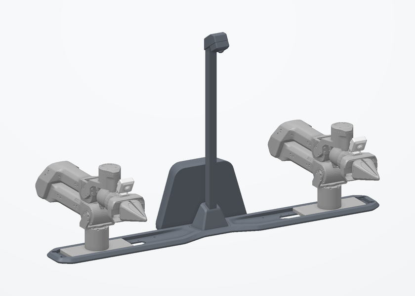
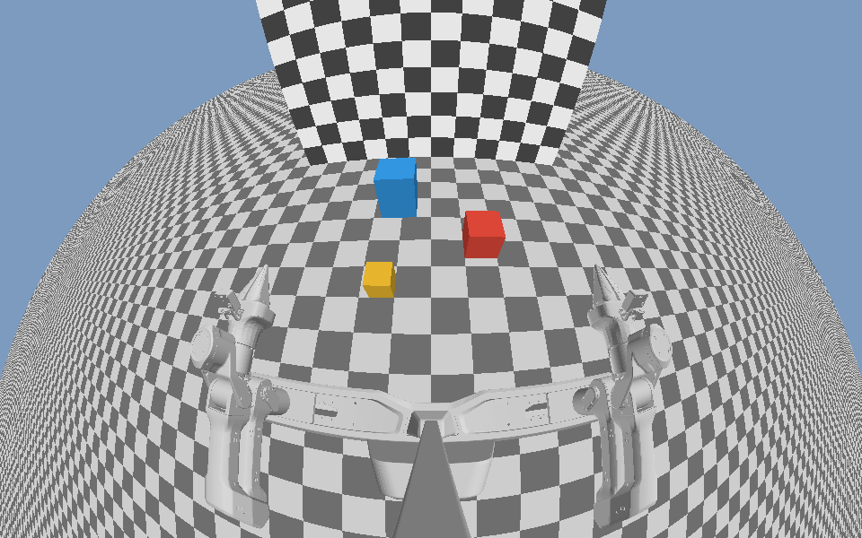

# LEMO robot description

## Table of Contents / 目录

- [URDF exterior previews](#urdf-exterior-previews)
- [Display](#display)
- [Model](#model)
- [左右臂安装间距](#左右臂安装间距)
- [相机安装与坐标系](#相机安装与坐标系)
  - [头部相机立杆 CAD](#头部相机立杆-cad)
- [相机内参](#相机内参)
- [ROS 2 / RViz2 三相机鱼眼预览](#ros-2--rviz2-三相机鱼眼预览)

## URDF exterior previews

| Model | URDF file | Preview |
| --- | --- | --- |
| LEMO | [`LEMO.urdf`](urdf/LEMO.urdf) | <a href="previews/lemo.png"></a> |

ROS 1 catkin description package for the LEMO dual-A1Z platform with G1Z grippers,
two wrist cameras and one head camera.
The ROS package name is `lemo_description`.

## Display

Place this package in a catkin workspace, build the workspace and source its
`devel/setup.bash`, then run:

```bash
roslaunch lemo_description display.launch
```

Use `gui:=false` to publish default joint states without joint sliders.

## Model

- `urdf/LEMO.urdf`: 25 links and 24 joints, including six revolute joints per arm
  and two prismatic finger joints per gripper. Each right finger mimics its
  corresponding left finger with multiplier -1.
- `meshes/`: all visual and collision meshes referenced by the URDF.
- `config/LEMO.rviz`: RViz configuration with fixed frame `base_link`.
- `config/base_mass_properties.json`: base CAD mass properties and mesh
  registration provenance; this file is not loaded at runtime.

Lengths are in metres, masses in kilograms and inertias in kg m². The base STL
uses scale `0.001 0.001 0.001`; arm meshes use unit scale.

Base mesh registration is estimated from mesh geometry and uniform-density
mass properties and has not been confirmed against the CAD frame. Gripper
limits of 3 N and 10.47 m/s are inherited values, not validated hardware limits.
The historical `rIght` spelling in finger names is retained for compatibility.

## 左右臂安装间距

左右臂可独立选择距 `base_link` 中心的安装档位。默认左右各 **375 mm**，两臂安装中心距为 **750 mm**。

| 单侧距中心（mm） | 左臂 `L_arm_mount_joint` 的 `origin xyz`（m） | 右臂 `R_arm_mount_joint` 的 `origin xyz`（m） |
| --- | --- | --- |
| 300 | `0 0.300 0.005` | `0 -0.300 0.005` |
| 325 | `0 0.325 0.005` | `0 -0.325 0.005` |
| 350 | `0 0.350 0.005` | `0 -0.350 0.005` |
| **375（默认）** | `0 0.375 0.005` | `0 -0.375 0.005` |

在 [`urdf/LEMO.urdf`](urdf/LEMO.urdf) 中找到对应的安装关节，按表修改 `origin xyz` 的第二个数（Y）。
左臂取正值，右臂取负值。两臂安装中心距是两侧档位之和，例如左侧 350 mm、右侧 300 mm 时，中心距为 650 mm。
保存后重启 `roslaunch lemo_description display.launch`。如果另存为新的 URDF，启动时加上 `model:=<新文件的绝对路径>`。

## 相机安装与坐标系

左右臂复用 `a1z_g1z_camera_description` 最终版的相机模型和安装变换。
原有机械臂、夹爪关节及命名保持不变，增加以下固定链：

- `L_arm_link6 -> L_camera_link -> L_camera_optical_frame`
- `R_arm_link6 -> R_camera_link -> R_camera_optical_frame`
- `base_link -> head_camera_link -> head_camera_optical_frame`

以下平移单位为米，RPY 单位为弧度，均在父坐标系中表达：

| 父坐标系 | 子坐标系 | xyz | rpy |
| --- | --- | --- | --- |
| `L_arm_link6` / `R_arm_link6` | `L_camera_link` / `R_camera_link` | `0.06125 0 0.0311` | `0 0 -1.570796326794897` |
| `base_link` | `head_camera_link` | `0.012738728387804 0 0.538944931458535` | `-0.541052068118242 0 -1.570796326794897` |
| 各 `camera_link` | 对应 `camera_optical_frame` | `0 0.02379 0.02788` | `-2.059488517353309 0 0` |

腕部光心相对对应 `arm_link6` 为 `(0.08504, 0, 0.05898)`，
从 +X 向 -Z 下倾 28°。头部给定尺寸按**光心**解释：相对 LEMO
`base_link` 为 `(0.04749, 0, 0.55059)`，Y = 0，
从 +X 向 -Z 下倾 59°。头部光学坐标系相对 base 的 RPY 为
`(-149°, 0°, -90°)`，光轴方向为 `(cos(59°), 0, -sin(59°))`。

头部相机外观已包含在 `base_link.STL` 中，因此 `head_camera_link` 仅保留
坐标系，不重复添加 visual 或 collision。为保持 TF 兼容，继续沿用相同的
外壳到光心变换：将腕部相机姿态绕父坐标系 Y 轴额外下倾 31°，
再根据指定光心位置反算该辅助坐标系的原点。
三台相机均采用光学约定：**+X 向右、+Y 向下、+Z 向前**。
相机没有添加未知的质量和惯量；上述安装外参为给定尺寸下的名义值，
尚未通过实物标定验证。

### 头部相机立杆 CAD

完整立杆和立杆上端各有 STEP 模型、PDF 图纸和外观预览。见 [CAD 仓库的 LEMO 目录](https://github.com/userguide-galaxea/CAD_files/tree/main/LEMO)。

## 相机内参

三台相机复用 A1Z 的 **1920×1200 原始鱼眼图像**标定，模型为
`equidistant`（OpenCV fisheye），K、D、R、P 完全相同，分别使用：

| 相机 | 标定文件（相对包目录） | 图像和 CameraInfo 的 `header.frame_id` |
| --- | --- | --- |
| 左腕 | `config/L_camera_info.yaml` | `L_camera_optical_frame` |
| 右腕 | `config/R_camera_info.yaml` | `R_camera_optical_frame` |
| 头部 | `config/head_camera_info.yaml` | `head_camera_optical_frame` |

驱动通过独立命名空间发布各相机的图像与 CameraInfo，并加载对应文件，
例如 `package://lemo_description/config/head_camera_info.yaml`。
URDF 和 display launch 仅定义模型和 TF，不发布图像或 CameraInfo，
也未配置 Gazebo 图像传感器。

`config/camera_metadata.yaml` 记录三个 frame、标定文件及厂家名义视场角
（对角 220°、水平 210°、垂直 128°）；名义视场角不是实测有效像素掩码。
标定仅适用于相同的原始图像几何，裁剪、缩放、旋转或去畸变后需对应调整。
R 为单位矩阵，P 为 `[K | 0]`，并不代表已验证的去畸变输出内参。

## ROS 2 / RViz2 三相机鱼眼预览

在已安装 ROS 2、RViz2、`robot_state_publisher`、
`joint_state_publisher_gui`、NumPy、PyYAML 和 OpenCV 的环境中运行。
以下命令从仓库根目录执行；`ros-jazzy` 为本机已安装依赖的 conda 环境名，
其他环境激活 ROS 2 后可直接使用 `python`：

```sh
conda run --no-capture-output -n ros-jazzy python \
  lemo_description/preview/run_preview.py
```

RViz2 显示完整 LEMO、三台相机的坐标轴和光轴、棋盘格/色块场景，
以及 `Left Wrist Fisheye`、`Right Wrist Fisheye`、`Head Fisheye` 三个图像面板。
独立的关节滑块窗口控制左右臂各六个关节和各自左指关节，右指按 mimic 联动。
任一关节变化会重新计算三路图像，因此也支持两臂之间的遮挡和头部观察双臂。
头部光心和姿态固定在 base 上，不随关节移动。

- 默认每路 **960×600**，K 按比例缩小，D 不变；`--scale 1` 为
  1920×1200，`--scale 4` 为 480×300。检测到关节变化时渲染，发布定时器为
  0.5 秒，实际刷新率受渲染耗时影响。
- 三路 topic 前缀为 `/lemo_camera_preview/L`、`/lemo_camera_preview/R`、
  `/lemo_camera_preview/head`，各自发布 `image_raw`、`camera_info` 和
  `self_occlusion_mask`（`mono8`，255 表示机器人遮挡测试场景）。
- 自遮挡使用底座、双臂和夹指的 **21 个实际 visual STL**（含两台腕部相机外壳），包括 visual
  origin、底座的 `0.001` 缩放及夹指 mimic，按最近表面与场景深度比较。
  各腕部视角仅排除其自身相机外壳，避免将镜片当作不透明表面；
  头部视角包含左右腕部相机外壳，腕部视角也保留另一侧相机外壳。
  头部相机集成在底座 STL 中，采用下述局部光学通道处理。
- 渲染复用同仓库 `a1z_g1z_camera_description/preview` 的鱼眼模型、场景与
  C++ BVH，需保留该包。首次运行需 C++17 编译器；编译缓存、缩放网格缓存、
  ROS 2 临时资源索引和运行日志位于系统临时目录。
- 沿用 A1Z 的厂家名义对角 FOV ±110° 角域限制，并非实测有效图像掩码。
  仅作几何/光学预览，不模拟动力学、接触、透明、反射或实际光照。
- 默认临时选择独立的 `ROS_DOMAIN_ID`，启动时打印；若环境已设置该变量，
  则使用已有值。关闭 RViz2/滑块窗口或在启动终端按 Ctrl+C 可结束预览。

**头部光学通道：**底座 STL 已包含相机，但没有透明镜片定义。若将所有
三角面当作不透明物体，头部中心射线在约 1.726 mm 处命中内置相机表面，
整幅图像会被虚假遮住；这不能据此认定给定相机位置错误。
预览仅对**头部视角的 base_link 射线求交**跳过距光心 30 mm 以内的表面，
作为光学通道的近似。更远的底座表面、所有双臂/夹指表面仍按原始深度遮挡；
左右腕部对底座的遮挡计算不变，RViz 中完整底座也照常显示。
30 mm 是预览用的局部避让范围，不是实测镜片孔径或精确玻璃材质模型，
后续可用分离的镜片/外壳 CAD 改进。相机位置、下倾角和标定参数均未调整。
头部零位画面可看到左右臂及其腕部相机外壳，单独改变任一侧关节均会改变头部图像。
可用 `--no-self-occlusion` 查看无机器人遮挡的参考场景。

头部零位鱼眼预览（含两侧腕部相机外壳）：



离线验证和导出图像：

```sh
conda run --no-capture-output -n ros-jazzy python \
  lemo_description/preview/verify_preview.py
conda run --no-capture-output -n ros-jazzy python \
  lemo_description/preview/run_preview.py \
  --render-only /tmp/lemo-camera-images
```

已在本机 ROS 2 Jazzy 环境验证三路图像、CameraInfo、遮挡掩码、16 个关节状态
及 RViz2 三路图像订阅；离线检查覆盖实际网格遮挡、场景深度、双臂 FK、
固定头部外参、左右夹指 mimic、两台腕部相机在头部图像中的可见性和局部光学通道。ROS 1 display launch 尚未在本次修改中运行。
