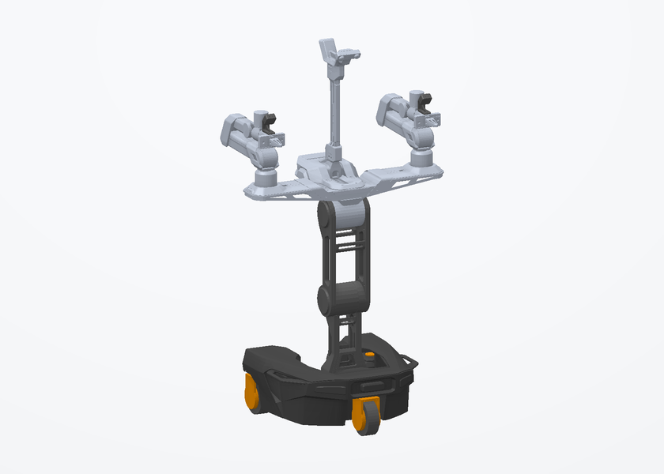
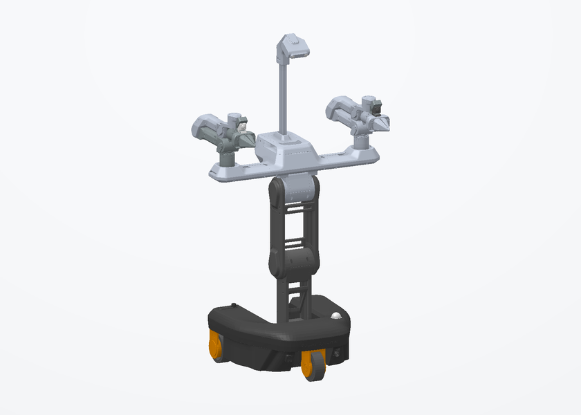

# R1 Lite robot descriptions

## URDF exterior previews

| Model | URDF file | Preview |
| --- | --- | --- |
| R1 Lite 2025 | [`urdf_r1lite_2025.urdf`](urdf_r1lite_2025.urdf) |  |
| R1 Lite 2026 A1X | [`urdf_r1lite_2026_a1x.urdf`](urdf_r1lite_2026/urdf_r1lite_2026_a1x.urdf) |  |
| R1 Lite 2026 A1Z | [`urdf_r1lite_2026_a1z.urdf`](urdf_r1lite_2026/urdf_r1lite_2026_a1z.urdf) |  |

These previews use the mesh sets from the separate R1 Lite ROS 2 description package.
