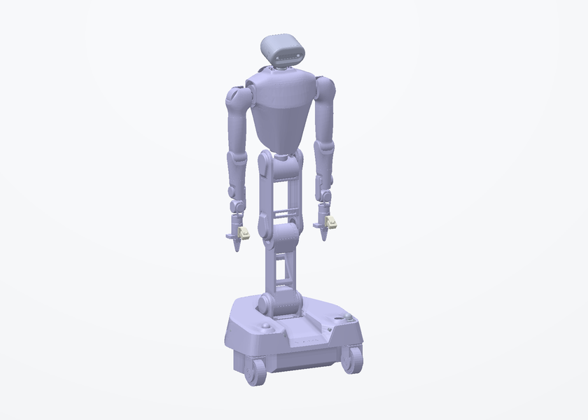
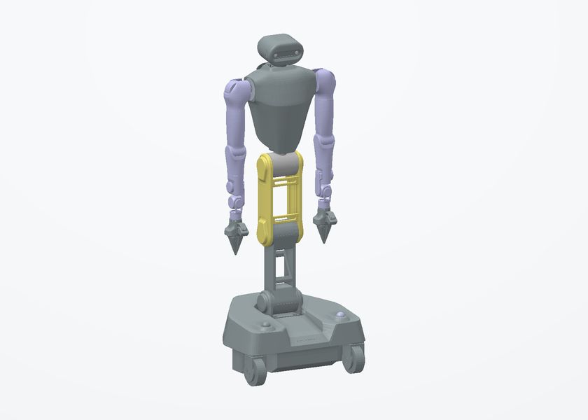

# R1 Pro robot descriptions

## URDF exterior previews

| Model | URDF file | Preview |
| --- | --- | --- |
| R1 Pro 2025 (approximate) | [`urdf_r1pro_2025.urdf`](urdf_r1pro_2025.urdf) |  |
| R1 Pro 2026 G1Z | [`r1pro_2026.urdf`](r1pro_g1z_2026_description/urdf/r1pro_2026.urdf) |  |

The R1 Pro 2025 URDF references meshes from the separate `mobiman` SDK. The approximate preview applies the 2025 transforms to the 2026 package's reference meshes, including the camera housings, and the G1-style gripper meshes from [GalaxeaManipSim](https://github.com/OpenGalaxea/GalaxeaManipSim).
